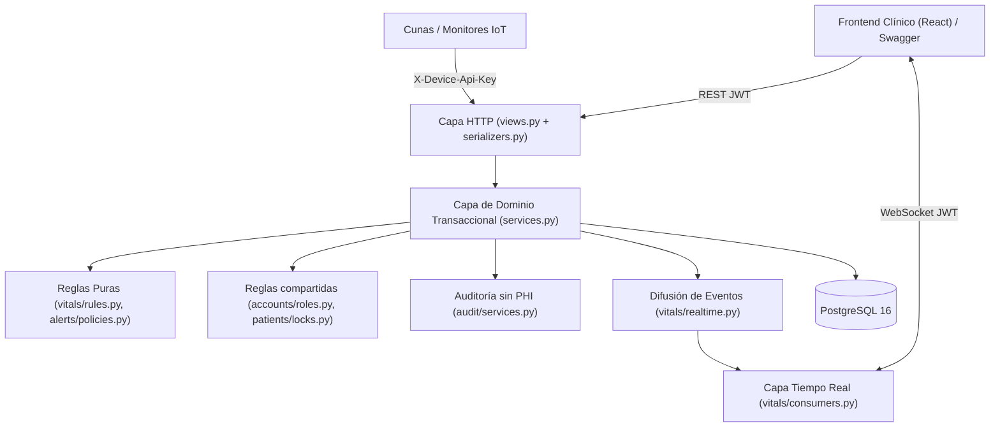

# Arquitectura del Sistema — Poki Koa Backend

**Poki Koa** es una plataforma backend de monitoreo clínico para Unidades de Cuidados Intensivos Neonatales (UCIN), construida como un monolito modular en Django y Django REST Framework con soporte de tiempo real mediante Django Channels y Redis.

---

## 1. Principios de Diseño

1. **Separación por aplicaciones de dominio (`src/`):** Cada contexto clínico acotado posee su propia aplicación independiente con modelos, servicios, serializadores, vistas y pruebas.
2. **Lógica de negocio en servicios (`services.py`), nunca en vistas (`views.py`):** Las vistas HTTP y consumidores WebSocket se limitan a validar entrada/salida y delegar las transiciones de estado a funciones transaccionales (`transaction.atomic()` + `select_for_update()`).
3. **Fuente única de verdad fisiológica (`vitals/rules.py` y `alerts/policies.py`):** Los límites físicos de aceptación de telemetría y los umbrales clínicos por defecto están centralizados en un único módulo puro y se replican como `CheckConstraint` en PostgreSQL.
4. **Conservación íntegra del historial clínico:** Ningún paciente, lectura de signos vitales, evolución de peso, alerta ni registro de auditoría se elimina físicamente. El alta o traslado se ejecuta como un egreso lógico (`discharge`).

> [!NOTE]
> Para la modelación de prioridades de alarma (IEC 60601-1-8), causas neonatales de egreso (clasificación OMS/UNICEF) y deduplicación de la curva ponderal se tomaron como referencia clínica los estándares de monitoreo neonatal y conceptos de dominio del proyecto abierto *IncuNest* (*Medical Open World*).

---

## 2. Capas y Módulos del Sistema

### Aplicaciones de dominio en `src/`

| Aplicación | Responsabilidad principal |
|---|---|
| `accounts` | Usuarios (`User`), autenticación por `username` y contraseña, roles clínicos (`admin`, `neonatologist`, `nurse`, `pharmacist`), rotación/revocación JWT, bloqueo por intentos fallidos y 2FA (TOTP). |
| `audit` | Registro inmutable (`AuditLog`) de accesos y modificaciones por paciente y recurso, almacenando únicamente los nombres de los campos alterados (`changed_fields`). |
| `devices` | Cunas/incubadoras (`Crib`), estado operativo (`available`, `occupied`, `maintenance`, `offline`), asignación de paciente y autenticación de telemetría por API Key. |
| `patients` | Ciclo clínico del recién nacido (`Patient`), ingreso, edición con control de acceso por campo, evolución ponderal (`WeightRecord`), planes de cuidado (`CarePlan`), observaciones (`ClinicalObservation`) y egreso lógico (`discharge`). |
| `vitals` | Reglas fisiológicas (`vitals/rules.py`), serie histórica de lecturas (`VitalSignReading`) y canales WebSocket en tiempo real (`vitals/consumers.py`). |
| `alerts` | Configuración de umbrales (`AlertThresholdConfig`), evaluación determinista (`alerts/policies.py`) y ciclo de vida de alertas (`Alert`). |
| `medications` | Catálogo de farmacia con control de inventario (`MedicationCatalogItem`), prescripciones médicas (`Prescription`) y administración atómica con descuento de stock. |

### Organización por capa dentro de cada aplicación

| Archivo | Responsabilidad | Regla |
|---|---|---|
| `views.py` + `serializers.py` | HTTP: autenticación, permisos DRF, validación de formato y serialización | Sin lógica de negocio |
| `services.py` | Operaciones de dominio transaccionales (la API pública de la app) | Única capa que escribe y audita |
| `models.py` | Esquema e invariantes de base de datos | — |
| `rules.py`, `policies.py`, `schedule.py`, `validators.py` | Reglas puras sin E/S | Una sola fuente por regla |

### Módulos compartidos (Guía Unidad 3)

| Módulo | Operaciones públicas | Consumidores |
|---|---|---|
| `accounts/roles.py` | Conjuntos de roles (`ADMIN_ONLY`, `CLINICAL_STAFF`, `CLINICAL_OR_ADMIN`, …), `has_role`, `require_role` | Servicios de `patients`, `alerts`, `medications`, `devices` y `accounts`; `accounts/permissions.py` |
| `patients/locks.py` | `lock_active_patient(patient_id, *, discharged_message)` | `patients`, `alerts` y `medications` |
| `medications/services.py` | `parse_concentration_mg`, `parse_stock`, `parse_min_stock_alert` | Alta y edición del catálogo |

---

## 3. Reglas Clínicas y Ciclo de Vida de Datos

### 3.1 Trazabilidad de telemetría y reasignación de cunas
Cada lectura en `VitalSignReading` registra tanto la cuna (`crib_id`) como el paciente activo en ese instante (`patient_id`) y la marca temporal (`recorded_at`). Cuando un paciente egresa o cambia de cuna, su historial permanece ligado a su identidad sin mezclarse con futuros ocupantes de la misma incubadora.

### 3.2 Evolución ponderal y edad dinámica
- La edad en días (`age_days`) nunca se persiste como columna estática: se calcula dinámicamente a partir de `birth_date`.
- El peso se almacena en gramos enteros (`birth_weight_g`, `current_weight_g`) junto con su serie temporal en `WeightRecord`, deduplicando lecturas consecutivas idénticas.

### 3.3 Motor de alertas clínicas (`alerts`)
Las alertas siguen tres niveles de severidad (`info`, `warning`, `critical`) y una máquina de estados explícita:
1. **`active`:** Alerta recién disparada al superar o caer bajo un umbral configurado. Si persiste la misma anomalía y severidad en lecturas sucesivas, se deduplica incrementando `occurrence_count` y actualizando `measured_value`.
2. **`acknowledged`:** Un profesional clínico reconoce la alerta (`acknowledged_by`, `acknowledged_at`), manteniendo su seguimiento activo hasta que el signo vital se normalice.
3. **`resolved`:** Se cierra automáticamente (`auto_normalized`) cuando una nueva lectura vuelve al rango normal, por escalamiento de severidad (`severity_escalated`), al egresar al paciente (`patient_discharged`) o por resolución manual (`manual`).
