# Esquema de Datos Relacional — Poki Koa v2

El modelo de datos se organiza en **7 aplicaciones de dominio** independientes dentro del monolito modular Django (`accounts`, `audit`, `devices`, `patients`, `vitals`, `alerts`, `medications`), diseñado para PostgreSQL y preparado para alta volumetría de series temporales y trazabilidad clínica completa.

## 1. Diagrama Entidad-Relación (ER)

```mermaid
erDiagram
    USER ||--o{ AUDIT_LOG : "generates"
    USER ||--o{ PATIENT : "attends (attending_physician)"
    USER ||--o{ PATIENT : "discharges (discharged_by)"
    USER ||--o{ WEIGHT_RECORD : "records"
    USER ||--o{ CARE_PLAN : "creates"
    USER ||--o{ CLINICAL_OBSERVATION : "authors"
    USER ||--o{ ALERT : "acknowledges"
    USER ||--o{ ALERT : "resolves"
    USER ||--o{ PRESCRIPTION : "prescribes"
    USER ||--o{ MEDICATION_ADMINISTRATION : "administers"
    PRESCRIPTION ||--o{ MEDICATION_ADMINISTRATION : "doses"

    CRIB ||--o| PATIENT : "hosts (current_patient)"
    CRIB ||--o{ VITAL_SIGN_READING : "emits"
    CRIB ||--o{ ALERT : "triggers"
    CRIB ||--o{ AUDIT_LOG : "actor_device"

    PATIENT ||--o{ WEIGHT_RECORD : "evolves"
    PATIENT ||--o{ CARE_PLAN : "has"
    PATIENT ||--o{ CLINICAL_OBSERVATION : "has"
    PATIENT ||--o{ VITAL_SIGN_READING : "recorded_for"
    PATIENT ||--o| ALERT_THRESHOLD_CONFIG : "customizes"
    PATIENT ||--o{ ALERT : "experiences"
    PATIENT ||--o{ PRESCRIPTION : "receives"
    PATIENT ||--o{ AUDIT_LOG : "subject_of"

    MEDICATION_CATALOG_ITEM ||--o{ PRESCRIPTION : "supplies"

    USER {
        bigint id PK
        string username UK
        string email UK
        string full_name
        string role "admin | neonatologist | nurse | pharmacist"
        string shift "morning | afternoon | night | null"
        boolean is_active
        boolean is_two_factor_enabled
        string totp_secret
        smallint failed_login_attempts
        datetime locked_until
        datetime created_at
        datetime updated_at
    }

    AUDIT_LOG {
        bigint id PK
        bigint actor_user_id FK "nullable"
        bigint actor_device_id FK "nullable"
        bigint patient_id FK "nullable"
        string action
        string resource_type
        string resource_id
        jsonb changed_fields "field names only, no PHI"
        inet ip_address
        datetime timestamp
    }

    CRIB {
        bigint id PK
        string code UK
        string name
        string location
        string status "available | occupied | maintenance | offline"
        string api_key_prefix
        string api_key_hash
        boolean is_device_active
        datetime last_telemetry_at
        datetime created_at
        datetime updated_at
    }

    PATIENT {
        bigint id PK
        string medical_record_number UK
        string full_name
        string sex "F | M"
        date birth_date
        decimal gestational_age_weeks
        int birth_weight_g
        int current_weight_g
        datetime admitted_at
        text diagnosis
        bigint attending_physician_id FK "nullable"
        bigint crib_id FK "OneToOne, nullable"
        string status "active | discharged | transferred | deceased"
        datetime discharged_at "nullable"
        string discharge_outcome "survived | transferred | deceased | unknown | null"
        string discharge_cause "none | prematurity | perinatal_asphyxia | sepsis | congenital_malformation | hypothermia | other | null"
        text discharge_notes
        bigint discharged_by_id FK "nullable"
        datetime created_at
        datetime updated_at
    }

    WEIGHT_RECORD {
        bigint id PK
        bigint patient_id FK
        int weight_g
        bigint recorded_by_id FK "nullable"
        datetime recorded_at
    }

    CARE_PLAN {
        bigint id PK
        bigint patient_id FK
        string care_area
        string intervention
        string frequency
        string status "active | suspended | completed"
        bigint created_by_id FK
        datetime created_at
        datetime updated_at
    }

    CLINICAL_OBSERVATION {
        bigint id PK
        bigint patient_id FK
        bigint author_id FK
        string category "general | nursing | medical | kangaroo_care | phototherapy"
        text content
        datetime created_at
    }

    VITAL_SIGN_READING {
        bigint id PK
        bigint crib_id FK
        bigint patient_id FK "nullable"
        smallint heart_rate "1..260 bpm"
        smallint spo2 "0..100 %"
        decimal temperature "25.0..45.0 C"
        string sleep_state "asleep | awake"
        boolean cannula_connected
        boolean iv_line_active
        datetime recorded_at
        datetime ingested_at
    }

    ALERT_THRESHOLD_CONFIG {
        bigint id PK
        bigint patient_id FK "OneToOne, nullable (null = default profile)"
        smallint heart_rate_critical_low "default 80"
        smallint heart_rate_warning_low "default 100"
        smallint heart_rate_warning_high "default 160"
        smallint heart_rate_critical_high "default 180"
        smallint spo2_critical_low "default 90"
        smallint spo2_warning_low "default 95"
        decimal temp_critical_low "default 36.0"
        decimal temp_warning_low "default 36.5"
        decimal temp_warning_high "default 37.5"
        decimal temp_critical_high "default 38.5"
        bigint updated_by_id FK "nullable"
        datetime updated_at
    }

    ALERT {
        bigint id PK
        bigint crib_id FK
        bigint patient_id FK "nullable"
        string alert_type "heart_rate | spo2 | temperature | cannula | sensor_fault | other"
        string severity "info | warning | critical"
        string status "active | acknowledged | resolved"
        string message
        decimal measured_value "nullable"
        decimal threshold_value "nullable"
        int occurrence_count
        datetime triggered_at
        datetime last_evaluated_at
        bigint acknowledged_by_id FK "nullable"
        datetime acknowledged_at "nullable"
        bigint resolved_by_id FK "nullable"
        datetime resolved_at "nullable"
        string resolution_reason "auto_normalized | manual | severity_escalated | patient_discharged | null"
    }

    MEDICATION_CATALOG_ITEM {
        bigint id PK
        string name UK
        string active_ingredient
        decimal concentration_mg "> 0"
        string unit
        int stock ">= 0"
        int min_stock_alert
        boolean is_active
        datetime created_at
        datetime updated_at
    }

    PRESCRIPTION {
        bigint id PK
        bigint patient_id FK
        bigint medication_id FK
        bigint prescribed_by_id FK
        string dose
        int units_per_administration ">= 1"
        string route "IV | IM | ET | PO | SC"
        datetime starts_at "primera dosis, truncada al minuto"
        int frequency_hours "nullable = dosis única; 1..168"
        datetime ends_at "nullable; solo recurrentes, > starts_at"
        string status "active | completed | cancelled"
        datetime cancelled_at "nullable"
        text cancellation_reason
        datetime created_at
        datetime updated_at
    }

    MEDICATION_ADMINISTRATION {
        bigint id PK
        bigint prescription_id FK
        datetime scheduled_for "UNIQUE con prescription_id"
        datetime administered_at
        bigint administered_by_id FK
        int units_deducted ">= 1"
        text notes
        datetime created_at
    }
```

---

## 2. Especificación por Aplicación de Dominio

### 2.1 `accounts` — Cuentas, Roles y Seguridad de Acceso
- **`User`** (`AbstractBaseUser`, `PermissionsMixin`):
  - `USERNAME_FIELD = "username"`.
  - `role`: `ADMIN`, `NEONATOLOGIST`, `NURSE`, `PHARMACIST`.
  - `shift`: `MORNING`, `AFTERNOON`, `NIGHT` (opcional).
  - Control de bloqueo por fuerza bruta: `failed_login_attempts` y `locked_until`.
  - Soporte 2FA: `is_two_factor_enabled` y `totp_secret`.
  - Índices: `username` (único), `email` (único), `(role, is_active)`.

### 2.2 `audit` — Auditoría Clínica sin Exposición de PHI
- **`AuditLog`**:
  - Registra lecturas y mutaciones sobre pacientes y recursos clínicos.
  - **Invariante de privacidad:** `changed_fields` almacena exclusivamente la lista de nombres de atributos modificados (ej. `["diagnosis", "crib_id"]`), jamás el contenido clínico ni datos identificables.
  - `on_delete = models.SET_NULL` en todas sus claves foráneas para que la pista de auditoría sea inmutable e indestructible.
  - Índices compuestos: `(patient, -timestamp)`, `(actor_user, -timestamp)`, `(resource_type, resource_id, -timestamp)`.

### 2.3 `devices` — Cunas / Incubadoras y Credenciales IoT
- **`Crib`**:
  - `code`: identificador único (ej. `C-01`).
  - `status`: `available`, `occupied`, `maintenance`, `offline`.
  - Autenticación de máquina: `api_key_prefix` (indexado para búsqueda O(1)) + `api_key_hash` (hash criptográfico; la clave en texto claro solo se entrega al generarla o rotarla).
  - `last_telemetry_at`: marca de tiempo de la última lectura recibida.

### 2.4 `patients` — Pacientes, Curva de Peso, Planes de Cuidado y Observaciones
- **`Patient`**:
  - `medical_record_number`: ficha clínica única (ej. `RN-0001`).
  - `birth_weight_g` y `current_weight_g`: enteros en gramos (`CheckConstraint` `200 <= weight <= 10000`).
  - `gestational_age_weeks`: `Decimal(4, 1)` (`CheckConstraint` `20.0 <= gestational_age_weeks <= 45.0`).
  - `crib`: `OneToOneField(Crib, on_delete=models.SET_NULL, null=True, blank=True, related_name="current_patient")`. Garantiza que una cuna tenga a lo sumo un paciente activo asignado y que un paciente ocupe a lo sumo una cuna.
  - **Baja lógica e invariante de egreso:** No existe borrado físico (`on_delete=models.PROTECT` en todas las entidades clínicas hijas). Al ejecutar el servicio `discharge_patient()`, dentro de `transaction.atomic()`, se actualiza `status` (`discharged`, `transferred` o `deceased`), se sellan `discharged_at`, `discharge_outcome`, `discharge_cause`, `discharged_by`, se libera `patient.crib = None` (pasando la cuna a `available`) y se resuelven las alertas pendientes asociadas al paciente con `resolution_reason = "patient_discharged"`.
- **`WeightRecord`**:
  - Serie histórica de evolución ponderal por paciente (`(patient, -recorded_at)`). Si el nuevo peso coincide exactamente con el último registrado para el paciente, el servicio deduplica el punto o actualiza `current_weight_g`.
- **`CarePlan`** y **`ClinicalObservation`**:
  - Protocolos de cuidado e historial de observaciones clínicas firmadas por su autor (`author` / `created_by`), ambos con `on_delete=models.PROTECT` hacia `Patient`.

### 2.5 `vitals` — Fuente Única de Verdad e Histórico de Telemetría
- **Reglas fisiológicas (`vitals/rules.py`):**
  - Rangos de validación física de frontera (rechazo atómico HTTP 400 si cualquier campo falla):
    - `heart_rate`: `1..260` bpm (entero).
    - `spo2`: `0..100` % (entero).
    - `temperature`: `25.0..45.0` °C (`Decimal`).
    - `sleep_state`: `asleep` | `awake`.
    - `cannula_connected`, `iv_line_active`: booleanos estrictos (`isinstance(val, bool)`).
- **`VitalSignReading`**:
  - Cada ingesta válida inserta un registro inmutable vinculado a `crib` y a `crib.current_patient` (si la cuna está ocupada en ese momento).
  - Restricciones SQL (`CheckConstraint`) idénticas a `vitals/rules.py` para defensa en profundidad.
  - Índices compuestos de series temporales: `(patient, -recorded_at)` y `(crib, -recorded_at)`.

### 2.6 `alerts` — Motor de Alertas y Umbrales Configurables
- **`AlertThresholdConfig`**:
  - Permite definir umbrales por defecto (`patient = NULL`) o personalizados por paciente (`patient = <id>`), validando la invariante de orden estricto:
    - `heart_rate_critical_low < heart_rate_warning_low < heart_rate_warning_high < heart_rate_critical_high`
    - `spo2_critical_low < spo2_warning_low <= 100`
    - `temp_critical_low < temp_warning_low < temp_warning_high < temp_critical_high`
- **`Alert`**:
  - Estados: `active`, `acknowledged`, `resolved`.
  - **Deduplicación:** Si al evaluar una lectura ya existe una alerta no resuelta (`status__in=["active", "acknowledged"]`) del mismo `alert_type` y misma `severity` en la cuna, no se crea un duplicado: se actualiza `measured_value`, `message`, `last_evaluated_at` y se incrementa `occurrence_count`.
  - **Cambio de severidad:** Si la anomalía cambia de severidad (p. ej. de `warning` a `critical`), la alerta previa pasa a `resolved` (`resolution_reason = "severity_escalated"`) y se abre una nueva alerta `active` con la nueva severidad.
  - **Autorresolución:** Cuando una lectura posterior muestra que el parámetro evaluado volvió al rango normal, toda alerta abierta (`active` o `acknowledged`) de ese `alert_type` en la cuna pasa automáticamente a `status = "resolved"` con `resolution_reason = "auto_normalized"` y `resolved_at = now()`.
  - **Reconocimiento (`acknowledge`):** Un usuario autorizado marca una alerta `active` como `acknowledged`, sellando `acknowledged_by` y `acknowledged_at`.

### 2.7 `medications` — Catálogo con Stock, Indicaciones y Administración Atómica
- **`MedicationCatalogItem`**:
  - `concentration_mg > 0` y `stock >= 0` protegidos mediante validadores y `CheckConstraint` en base de datos (`catalog_concentration_positive`, `catalog_stock_non_negative`).
- **`Prescription`**:
  - Vincula obligatoriamente `patient` (`Patient`) con `medication` (`MedicationCatalogItem`) y `prescribed_by` (`User`).
  - **Esquema de dosis:** las dosis se programan en `starts_at + k · frequency_hours` (k = 0, 1, 2…) hasta `ends_at`. Sin `frequency_hours` es una dosis única en `starts_at`; sin `ends_at`, la indicación recurrente sigue vigente hasta que se cancela o el paciente egresa. Los cálculos de horario viven en `medications/schedule.py` (fuente única de verdad).
  - **Estados:** `active` (vigente) → `completed` al administrar la última dosis programada, o → `cancelled` por un neonatólogo o por el egreso del paciente.
  - **Administración transaccional (`administer_prescription`):**
    1. Dentro de `transaction.atomic()`, bloquea las filas de `Prescription` y `MedicationCatalogItem` con `select_for_update()`.
    2. Si `prescription.status != "active"`, aborta con `409 Conflict`.
    3. Resuelve la dosis: sin `scheduled_for`, toma la más reciente ya habilitada (se permite hasta 60 minutos antes de su horario); con `scheduled_for`, exige que sea un horario válido del esquema (si no, `400`) y que no esté a más de 60 minutos en el futuro (si no, `409`).
    4. Si esa dosis ya tiene registro, aborta con `409 Conflict`. La restricción única `administration_unique_dose_slot` (`prescription_id`, `scheduled_for`) lo garantiza también en la base de datos.
    5. Si `medication.stock < units_per_administration`, aborta con `409 Conflict` (impide stock negativo).
    6. Descuenta stock, crea `MedicationAdministration`, marca `completed` si era la última dosis y emite el registro en `AuditLog`.
  - **Dosis atrasadas:** `next_dose_at` es la siguiente dosis después de la última administrada, e `is_overdue` se activa 30 minutos después de su horario. Si una dosis antigua nunca se registra, se considera omitida en cuanto se administra una posterior.
