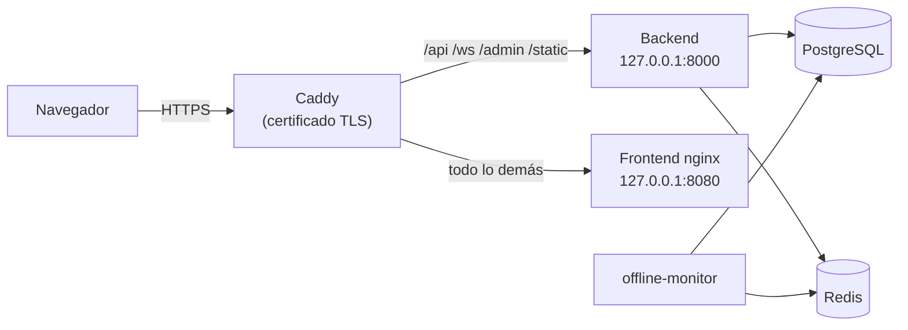

# Despliegue de Poki Koa

Guía corta para levantar Poki Koa en un servidor propio. Cada centro despliega su propia instancia con su dominio; en los ejemplos se usa `pokikoa.example.org`. La guía detallada está en [DEPLOYMENT_AND_OPERATIONS.md](DEPLOYMENT_AND_OPERATIONS.md).

## Cómo queda armado

Todo corre en un solo servidor con Docker. El navegador ve un único dominio: el proxy (Caddy) manda la API y los WebSockets al backend y el resto al frontend.



PostgreSQL y Redis no se exponen fuera de Docker. El backend y el frontend solo escuchan en `127.0.0.1`, así que desde internet únicamente se llega por Caddy.

## Qué cambiamos para poder desplegar

Backend:

- `docker-compose.prod.yml` con API, PostgreSQL, Redis y el monitor de cunas. Se niega a arrancar si faltan los secretos.
- `.env.prod.example` como plantilla de configuración.
- El `Dockerfile` ya no incluye herramientas de desarrollo y arranca con `settings.prod`.
- `/api/v1/health/ready/`: healthcheck que solo revisa la base de datos.
- La IP de la auditoría y el límite de login ya no se pueden falsear con `X-Forwarded-For`.
- Los WebSockets rechazan conexiones desde otros sitios.
- `seed_demo` no crea usuarios con contraseñas públicas en producción.

Frontend:

- `Dockerfile` que compila la app y la sirve con nginx. La imagen no lleva ningún dominio, así que sirve para cualquier centro.

En ambos repos, el CI ahora también corre en los PR hacia `desarrollo`.

## Qué va en GitHub y qué no

| En el repositorio (igual para todos) | Solo en el servidor de cada centro |
| --- | --- |
| Código, `Dockerfile`, `docker-compose.prod.yml` | `.env` con dominio, contraseñas y `SECRET_KEY` |
| `.env.prod.example` con valores de ejemplo | Configuración de Caddy con el dominio real |
| Esta guía | Respaldos de la base de datos |

## Pasos

Se necesita un servidor con Docker y el plugin `docker compose`, un dominio que apunte a ese servidor y los puertos 80 y 443 libres para Caddy.

1. **Clonar** los dos repositorios, uno al lado del otro:

   ```bash
   git clone https://github.com/PokiKoa/backend.git
   git clone https://github.com/PokiKoa/frontend.git
   ```

2. **Configurar el backend.** Copiar la plantilla y completar las cuatro variables obligatorias: `SECRET_KEY`, `POSTGRES_PASSWORD`, `ALLOWED_HOSTS` y `CORS_ALLOWED_ORIGINS`.

   ```bash
   cd backend
   cp .env.prod.example .env
   python3 -c "import secrets; print(secrets.token_urlsafe(50))"   # para SECRET_KEY
   python3 -c "import secrets; print(secrets.token_urlsafe(32))"   # para POSTGRES_PASSWORD
   chmod 600 .env
   ```

3. **Levantar el backend:**

   ```bash
   docker compose -f docker-compose.prod.yml up -d --build --wait
   ```

4. **Levantar el frontend:**

   ```bash
   cd ../frontend
   docker build -t poki-koa-frontend:prod .
   docker run -d --name poki-koa-frontend --restart unless-stopped -p 127.0.0.1:8080:8080 poki-koa-frontend:prod
   ```

5. **Configurar Caddy** con el dominio del centro (por ejemplo, en `/etc/caddy/Caddyfile`). Caddy obtiene el certificado solo:

   ```caddy
   pokikoa.example.org {
   	@backend path /api/* /ws/* /admin/* /static/*
   	handle @backend {
   		reverse_proxy 127.0.0.1:8000
   	}
   	handle {
   		reverse_proxy 127.0.0.1:8080
   	}
   }
   ```

6. **Crear el primer usuario:**

   ```bash
   cd ../backend
   docker compose -f docker-compose.prod.yml exec app uv run poki_koa createsuperuser
   ```

   Para cargar los datos ficticios de demostración, usar una contraseña propia (las de desarrollo se rechazan):

   ```bash
   docker compose -f docker-compose.prod.yml exec -e SEED_DEMO_PASSWORD='<contraseña segura>' app uv run poki_koa seed_demo
   ```

7. **Comprobar** que responde:

   ```bash
   curl https://pokikoa.example.org/api/v1/health/ready/   # {"status": "ok"}
   ```

## Mantenimiento

| Tarea | Comando (desde `backend/`) |
| --- | --- |
| Ver el estado | `docker compose -f docker-compose.prod.yml ps` |
| Ver los logs | `docker compose -f docker-compose.prod.yml logs -f app` |
| Actualizar | `git pull` y `docker compose -f docker-compose.prod.yml up -d --build --wait` (las migraciones se aplican solas) |
| Respaldar | `docker compose -f docker-compose.prod.yml exec -T db pg_dump -U poki_koa -Fc poki_koa > respaldo-$(date +%F).dump` |

Para actualizar el frontend, repetir el paso 4 después de `git pull`, borrando antes el contenedor anterior con `docker rm -f poki-koa-frontend`.

## Problemas comunes

| Síntoma | Causa |
| --- | --- |
| `compose` dice "Falta SECRET_KEY en .env" | Falta completar `.env` (paso 2) |
| La página redirige en bucle | El proxy no envía `X-Forwarded-Proto: https`. Caddy lo hace por defecto |
| Error 400 Bad Request | El dominio no está en `ALLOWED_HOSTS` |
| El tiempo real no conecta | El dominio de la página no está en `ALLOWED_HOSTS` ni en `CORS_ALLOWED_ORIGINS` |
| Caddy no obtiene el certificado | El dominio no apunta al servidor o los puertos 80/443 están ocupados |

Poki Koa usa solo datos ficticios. Esta configuración no sirve para datos reales de pacientes.
