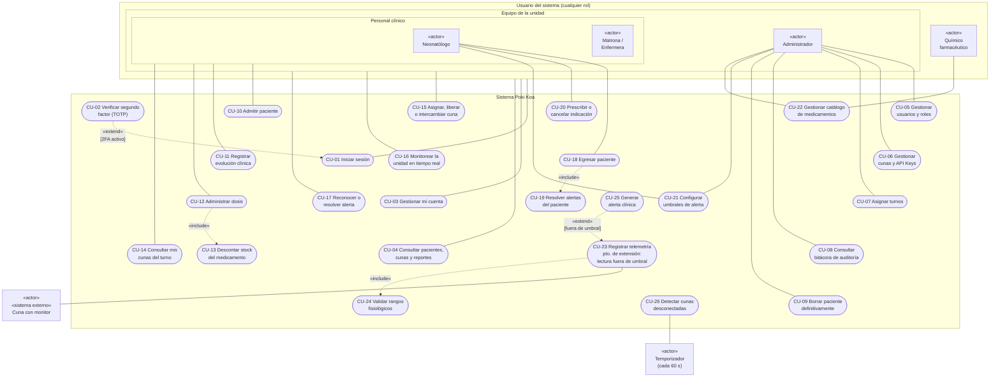

# 1. Diagrama de casos de uso

Quiénes usan Poki Koa y qué puede hacer cada uno, según los permisos que el backend aplica hoy (`accounts/roles.py`, `accounts/permissions.py` y `require_role` en cada `services.py`).

**Convenciones del dibujo.** Mermaid no tiene un tipo de diagrama de casos de uso, así que se representa con un diagrama de flujo:

- La frontera del sistema es el recuadro *Sistema Poki Koa*. Cada caso de uso es una elipse.
- Una línea sin flecha es una asociación entre un actor y un caso de uso.
- **Generalización de actores:** los recuadros que agrupan actores (*Usuario del sistema*, *Equipo de la unidad*, *Personal clínico*) son actores abstractos. Todo actor dentro de un recuadro hereda los casos de uso conectados a ese recuadro. Por ejemplo, la Matrona hereda *Admitir paciente* (de Personal clínico), *Monitorear la unidad* (de Equipo de la unidad) e *Iniciar sesión* (de Usuario del sistema). Cada recuadro corresponde a un conjunto de roles de `accounts/roles.py`: `CLINICAL_STAFF` y `CLINICAL_OR_ADMIN`.
- Las flechas punteadas son `«include»` (del caso base al incluido) y `«extend»` (del caso que extiende al caso base, con su condición entre corchetes).
- Los enlaces invisibles (`~~~`) del código solo ordenan los casos de uso en columnas; no son relaciones.

## Trazabilidad con el código

| Caso de uso | Actores | Dónde está implementado |
|---|---|---|
| CU-01 Iniciar sesión | Todos | `POST /api/v1/auth/login/` → `accounts.services.authenticate_user` |
| CU-02 Verificar segundo factor (TOTP) | Todos con 2FA activo | `authenticate_user` exige `otp_code` si `is_two_factor_enabled` (`accounts/totp.py`) |
| CU-03 Gestionar mi cuenta | Todos | `/auth/change-password/`, `/auth/2fa/setup/`, `/auth/2fa/enable/`, `/auth/2fa/disable/` |
| CU-04 Consultar pacientes, cunas y reportes | Todos | `GET /patients/`, `GET /cribs/` (incluye búsqueda por código QR), `/monitoring/overview/`, `/reports/summary/`, `/reports/series/` |
| CU-05 Gestionar usuarios y roles | Administrador | `/users/` → `create_user_by_admin`, `update_user_by_admin` (`IsAdminRole`) |
| CU-06 Gestionar cunas y API Keys | Administrador | `POST/PATCH /cribs/`, `POST /cribs/{id}/rotate-key/` → `create_crib`, `update_crib`, `rotate_crib_api_key` |
| CU-07 Asignar turnos | Administrador | `/shift-assignments/` → `create_shift_assignment`, `delete_shift_assignment` |
| CU-08 Consultar bitácora de auditoría | Administrador | `GET /audit-logs/` (`IsAdminRole`) |
| CU-09 Borrar paciente definitivamente | Administrador | `POST /patients/{id}/delete-permanently/` → `delete_patient_permanently` (`ADMIN_ONLY` y confirmación con la ficha) |
| CU-10 Admitir paciente | Neonatólogo, Matrona | `POST /patients/` → `admit_patient` (`CLINICAL_STAFF`) |
| CU-11 Registrar evolución clínica | Neonatólogo, Matrona | `/patients/{id}/weights/`, `/care-plans/`, `/observations/` → `record_patient_weight`, `create_care_plan`, `update_care_plan`, `create_clinical_observation` (`CLINICAL_STAFF`) |
| CU-12 Administrar dosis | Neonatólogo, Matrona | `POST /prescriptions/{id}/administer/` → `administer_prescription` (`CLINICAL_STAFF`) |
| CU-13 Descontar stock del medicamento | — (incluido) | Mismo servicio, en la misma transacción: `locked_medication.stock -= units_per_administration` |
| CU-14 Consultar mis cunas del turno | Neonatólogo, Matrona | `GET /shift-assignments/mine/` |
| CU-15 Asignar, liberar o intercambiar cuna | Administrador, Neonatólogo, Matrona | `/cribs/{id}/assign-patient/`, `/cribs/{id}/release/`, `/cribs/{id}/swap/` |
| CU-16 Monitorear la unidad en tiempo real | Administrador, Neonatólogo, Matrona | WebSocket `/ws/v1/monitoring/stream/` (el químico farmacéutico recibe cierre `4403`) |
| CU-17 Reconocer o resolver alerta | Administrador, Neonatólogo, Matrona | `/alerts/{id}/acknowledge/`, `/alerts/{id}/resolve/` → `acknowledge_alert`, `resolve_alert` (`CLINICAL_OR_ADMIN`) |
| CU-18 Egresar paciente | Neonatólogo | `POST /patients/{id}/discharge/` → `discharge_patient` (`NEONATOLOGIST_ONLY`) |
| CU-19 Resolver alertas del paciente | — (incluido) | `discharge_patient` llama siempre a `alerts.services.resolve_patient_alerts_on_discharge` (y además cancela las indicaciones pendientes) |
| CU-20 Prescribir o cancelar indicación | Neonatólogo | `POST /prescriptions/`, `/prescriptions/{id}/cancel/` → `create_prescription`, `cancel_prescription` (`NEONATOLOGIST_ONLY`) |
| CU-21 Configurar umbrales de alerta | Administrador, Neonatólogo | `/alert-thresholds/default/`, `/patients/{id}/alert-thresholds/` → `upsert_threshold_config` (`THRESHOLD_MANAGERS`) |
| CU-22 Gestionar catálogo de medicamentos | Administrador, Químico farmacéutico | `/medication-catalog/` → `create_catalog_item`, `update_catalog_item` (`CATALOG_MANAGERS`) |
| CU-23 Registrar telemetría | Cuna con monitor | `POST /cribs/{id}/telemetry/` con `X-Device-Api-Key` → `vitals.services.ingest_telemetry` |
| CU-24 Validar rangos fisiológicos | — (incluido) | `vitals.rules.validate_telemetry_payload` |
| CU-25 Generar alerta clínica | — (extensión) | `alerts.services.evaluate_reading_alerts` con `alerts.policies.evaluate_vital_reading` |
| CU-26 Detectar cunas desconectadas | Temporizador | Comando `check_offline_cribs --every 60` → `devices.services.detect_offline_cribs` (el personal también puede lanzarlo con `POST /cribs/check-offline/`) |

## Nota de lectura

Pusimos la frontera alrededor de lo que el equipo construyó (backend y frontend). La cuna física queda afuera, como actor externo: su firmware no es nuestro y se autentica con su propia API Key, no con una sesión de usuario. El químico farmacéutico no está asociado al monitoreo en tiempo real a propósito: el WebSocket lo rechaza con `4403`, porque su trabajo es el catálogo y no la vigilancia de signos vitales. Agrupamos a los actores según los conjuntos de roles que usa el código: *Personal clínico* es `CLINICAL_STAFF` y *Equipo de la unidad* es `CLINICAL_OR_ADMIN`. Las dos relaciones entre casos de uso responden a la frecuencia con que ocurren. *Egresar paciente* **incluye** *Resolver alertas del paciente* porque todo egreso cierra sus alertas. En cambio, *Generar alerta clínica* **extiende** *Registrar telemetría* porque la mayoría de las lecturas son normales y no generan alerta. Dejamos fuera la integración con otros sistemas del hospital (ficha electrónica, laboratorio): el sistema no la implementa.
