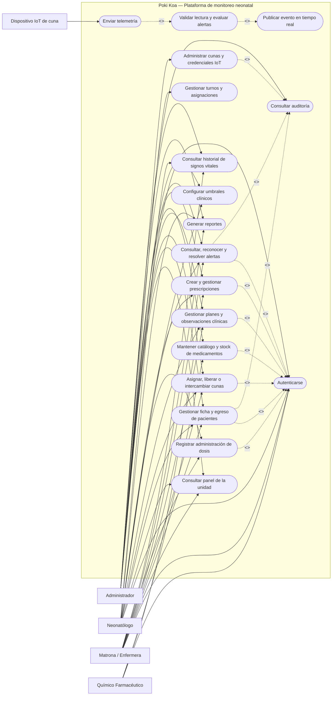

# 1. Diagrama de casos de uso

## Justificación de decisiones

La frontera agrupa las funciones implementadas por Poki Koa, mientras que los perfiles clínicos y administrativos se separan porque el backend aplica permisos RBAC por rol. El dispositivo IoT aparece como actor independiente: no inicia sesión como profesional, sino que envía telemetría autenticándose mediante `X-Device-Api-Key`. Se eligió mostrar la gestión clínica del paciente, las cunas, los signos vitales, las alertas, los medicamentos, los turnos, los reportes y la auditoría para cubrir los módulos presentes en ambos repositorios. La relación `include` hacia autenticación representa que las operaciones de la interfaz protegida requieren una sesión; el envío de telemetría incluye validación/evaluación y difusión de eventos según `vitals.services.ingest_telemetry`. La auditoría se incluye en operaciones sensibles porque los servicios de dominio registran los cambios sin guardar valores clínicos. Las funciones específicas de administración de credenciales y configuración se asignan al administrador, coherente con los permisos de las vistas y servicios.

## Alcance por actor

- **Administrador:** cuentas y roles, configuración de cunas y claves, turnos, umbrales globales, auditoría, reportes y operaciones clínicas permitidas.
- **Neonatólogo:** pacientes, planes/observaciones, umbrales, alertas, signos vitales, prescripciones y seguimiento clínico.
- **Matrona / Enfermera:** pacientes, asignación/liberación de cunas, observaciones, signos vitales, alertas y administración de dosis según permisos del servicio.
- **Químico Farmacéutico:** catálogo, stock y funciones de farmacia expuestas por el frontend y API.
- **Dispositivo IoT:** ingesta de telemetría para la cuna asociada a su API Key.

> Nota: el diagrama agrupa acciones relacionadas en casos de uso de nivel funcional. No afirma que cada rol tenga acceso irrestricto a todas las acciones dentro de un caso agrupado; la autorización fina se mantiene en `accounts/roles.py`, permisos DRF y servicios.