# 2. Diagrama de clases

Conceptos del dominio de Poki Koa tal como están en los modelos de Django (`src/*/models.py`). Cada clase usa el mismo nombre que su modelo, y cada atributo el mismo nombre que su campo.

```mermaid
classDiagram
    direction TB

    class AbstractBaseUser {
        <<Django>>
        +password: str
        +last_login: datetime
    }

    class PermissionsMixin {
        <<Django>>
        +is_superuser: bool
    }

    class User {
        +username: str
        +email: str
        +full_name: str
        +role: UserRole
        +shift: WorkShift
        +is_active: bool
        +failed_login_attempts: int
        +locked_until: datetime
        +is_two_factor_enabled: bool
        -totp_secret: str
        +is_temporarily_locked() bool
    }

    class UserRole {
        <<enumeration>>
        ADMIN
        NEONATOLOGIST
        NURSE
        PHARMACIST
    }

    class ShiftAssignment {
        +date: date
        +shift: WorkShift
        +created_by: User [1]
    }

    class Crib {
        +code: str
        +name: str
        +location: str
        +status: CribStatus
        +api_key_prefix: str
        -api_key_hash: str
        +is_device_active: bool
        +last_telemetry_at: datetime
    }

    class CribStatus {
        <<enumeration>>
        AVAILABLE
        OCCUPIED
        MAINTENANCE
        OFFLINE
    }

    class Patient {
        +medical_record_number: str
        +full_name: str
        +sex: PatientSex
        +birth_date: date
        +gestational_age_weeks: Decimal
        +birth_weight_g: int
        +current_weight_g: int
        +admitted_at: datetime
        +diagnosis: str
        +status: PatientStatus
        +discharged_at: datetime
        +discharged_by: User [0..1]
        +age_days() int
    }

    class AlertThresholdConfig {
        +heart_rate_critical_low: int
        +heart_rate_warning_low: int
        +heart_rate_warning_high: int
        +heart_rate_critical_high: int
        +spo2_critical_low: int
        +spo2_warning_low: int
        +temp_critical_low: Decimal
        +temp_warning_low: Decimal
        +temp_warning_high: Decimal
        +temp_critical_high: Decimal
        +updated_by: User [0..1]
    }

    class VitalSignReading {
        +heart_rate: int
        +spo2: int
        +temperature: Decimal
        +sleep_state: SleepState
        +cannula_connected: bool
        +iv_line_active: bool
        +recorded_at: datetime
        +ingested_at: datetime
    }

    class Alert {
        +alert_type: AlertType
        +severity: AlertSeverity
        +status: AlertStatus
        +message: str
        +measured_value: Decimal
        +threshold_value: Decimal
        +occurrence_count: int
        +triggered_at: datetime
        +acknowledged_by: User [0..1]
        +acknowledged_at: datetime
        +resolved_by: User [0..1]
        +resolved_at: datetime
        +resolution_reason: ResolutionReason
    }

    class AlertStatus {
        <<enumeration>>
        ACTIVE
        ACKNOWLEDGED
        RESOLVED
    }

    class WeightRecord {
        +weight_g: int
        +recorded_at: datetime
        +recorded_by: User [0..1]
    }

    class CarePlan {
        +care_area: str
        +intervention: str
        +frequency: str
        +status: CarePlanStatus
        +created_by: User [1]
    }

    class ClinicalObservation {
        +category: ObservationCategory
        +content: str
        +author: User [1]
    }

    class CribMovement {
        +kind: CribMovementKind
        +from_crib_code: str
        +to_crib_code: str
        +moved_at: datetime
        +moved_by: User [0..1]
    }

    class MedicationCatalogItem {
        +name: str
        +active_ingredient: str
        +concentration_mg: Decimal
        +unit: str
        +stock: int
        +min_stock_alert: int
        +is_active: bool
        +is_low_stock() bool
    }

    class Prescription {
        +dose: str
        +units_per_administration: int
        +route: AdministrationRoute
        +starts_at: datetime
        +frequency_hours: int
        +ends_at: datetime
        +status: PrescriptionStatus
    }

    class MedicationAdministration {
        +scheduled_for: datetime
        +administered_at: datetime
        +units_deducted: int
        +notes: str
    }

    class AuditLog {
        +actor_device_code: str
        +patient_id: int
        +action: AuditAction
        +resource_type: str
        +resource_id: str
        +changed_fields: list~str~
        +ip_address: str
        +timestamp: datetime
    }

    %% Herencia y enumeraciones
    AbstractBaseUser <|-- User
    PermissionsMixin <|-- User
    User ..> UserRole

    %% Personal y paciente
    User "0..1" -- "0..*" AuditLog : actor_user
    User "0..1" -- "0..*" Patient : attending_physician
    User "1" -- "0..*" ShiftAssignment : user

    %% Composición: los umbrales propios viven y mueren con su paciente (on_delete=CASCADE)
    Patient "0..1" *-- "0..1" AlertThresholdConfig : umbrales propios

    %% Evolución clínica
    Patient "1" -- "0..*" WeightRecord : patient
    Patient "1" -- "0..*" CarePlan : patient
    Patient "1" -- "0..*" ClinicalObservation : patient

    %% Telemetría y alertas
    Patient "0..1" -- "0..*" Alert : patient
    Patient "0..1" -- "0..*" VitalSignReading : patient
    Crib "1" -- "0..*" VitalSignReading : crib
    Crib "1" -- "0..*" Alert : crib
    Alert ..> AlertStatus

    %% Medicación
    User "1" -- "0..*" Prescription : prescribed_by
    User "1" -- "0..*" MedicationAdministration : administered_by
    MedicationCatalogItem "1" -- "0..*" Prescription : medication
    Prescription "1" -- "0..*" MedicationAdministration : prescription
    Patient "1" -- "0..*" Prescription : patient

    %% Cuna y paciente
    Crib "0..1" -- "0..1" Patient : crib
    Patient "1" -- "0..*" CribMovement : patient
    Crib "0..1" -- "0..*" CribMovement : from_crib / to_crib
    Crib "1" -- "0..*" ShiftAssignment : crib
    Crib ..> CribStatus
```

**Cómo leerlo.**

- Visibilidad: `+` es público; `-` marca los datos sensibles que la API nunca expone (`totp_secret`, `api_key_hash`).
- Atributos y tipos: los tipos son los de Python que usa cada campo. Se omiten `id`, `created_at` y `updated_at`, que tienen todos los modelos.
- Autoría: para no cruzar el dibujo, las claves foráneas de autoría (`created_by`, `recorded_by`, `author`, `moved_by`, `discharged_by`, `updated_by`, `acknowledged_by`, `resolved_by`) se muestran como atributos de tipo `User`, con su multiplicidad entre corchetes.
- Nombre de cada asociación: es el campo del modelo que la implementa.
- Enumeraciones: en el código son `TextChoices`. Solo se dibujan las tres que ayudan a leer el diagrama; las demás aparecen como tipo de su atributo.

## Correspondencia con el código

| Clase | Archivo |
|---|---|
| `User`, `UserRole`, `ShiftAssignment` | `src/accounts/models.py` |
| `Crib`, `CribStatus` | `src/devices/models.py` |
| `Patient`, `WeightRecord`, `CarePlan`, `ClinicalObservation`, `CribMovement` | `src/patients/models.py` |
| `VitalSignReading` | `src/vitals/models.py` |
| `Alert`, `AlertStatus`, `AlertThresholdConfig` | `src/alerts/models.py` |
| `MedicationCatalogItem`, `Prescription`, `MedicationAdministration` | `src/medications/models.py` |
| `AuditLog` | `src/audit/models.py` |
| `AbstractBaseUser`, `PermissionsMixin` | Django (`django.contrib.auth`), clases base de `User` |
