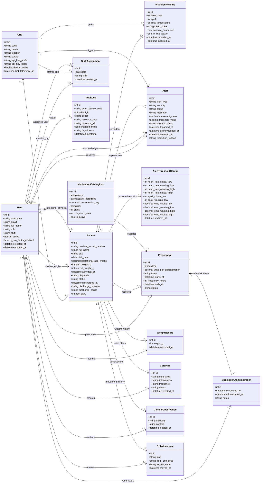

# 2. Diagrama de clases

## Justificación de decisiones

Se modelan las entidades persistentes que definen el dominio clínico y operativo, manteniendo los nombres usados en los modelos Django. `Patient` se conecta con sus lecturas, alertas, historial ponderal, planes, observaciones, prescripciones y movimientos de cuna porque el código conserva la trazabilidad por paciente. `Crib` tiene como máximo un paciente actual mediante `OneToOneField`, aunque conserva muchas lecturas y alertas históricas. Las multiplicidades opcionales reflejan las claves foráneas anulables, por ejemplo `VitalSignReading.patient`, `Alert.patient` y `AlertThresholdConfig.patient`. La composición entre `Prescription` y `MedicationAdministration` representa que cada administración pertenece a una prescripción y su ciclo de vida se gestiona desde ella; confirmar el detalle de borrado físico requiere revisar la política de retención de datos antes de cambiarla. `AuditLog` conserva actor y recurso, pero su campo `patient_id` es un identificador escalar y no una FK de Django; por eso no se dibuja como asociación formal a `Patient`. `age_days` se incluye como propiedad calculada, no como columna persistida.

## Criterios de lectura

- `+` indica visibilidad pública en la representación UML.
- Los tipos corresponden a tipos conceptuales de los campos Django; `datetime`, `date`, `decimal`, `json` e `int` resumen sus tipos persistidos.
- `0..1` indica una relación opcional o única; `0..*` indica colección histórica.
- Las clases de vistas, serializers, servicios y componentes React se describen en el diagrama de componentes, no como entidades de dominio.
