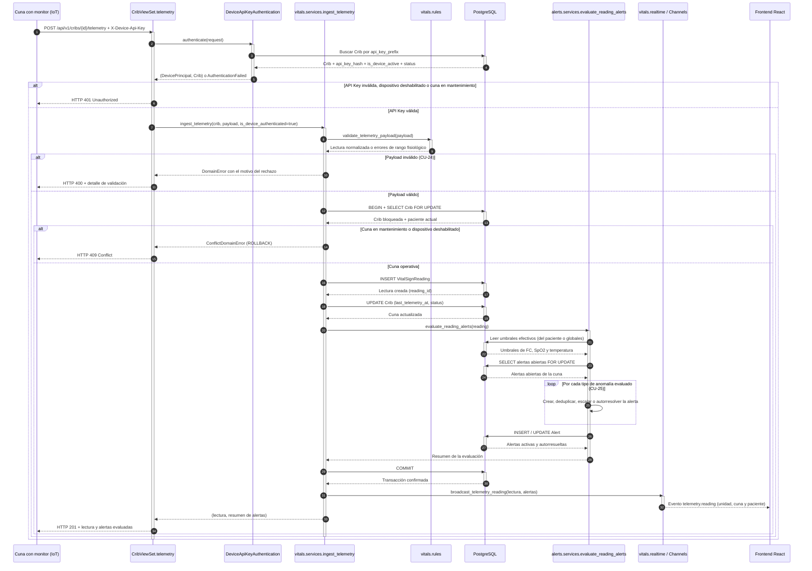

# 3. Diagrama de secuencia

**Caso de uso modelado:** *CU-23 Registrar telemetría* (diagrama de casos de uso, actor *Cuna con monitor*). Incluye *CU-24 Validar rangos fisiológicos* y, cuando la lectura sale de los umbrales, se extiende con *CU-25 Generar alerta clínica*. Es el flujo más completo del sistema: va desde la cuna hasta la pantalla del personal.

## Justificación de decisiones

Se modeló *Registrar telemetría* porque atraviesa todas las capas del sistema: la cuna se autentica con su API Key (no con JWT de usuario), se validan los rangos fisiológicos, se persiste la lectura en una transacción, se evalúan las alertas y el resultado llega en tiempo real a la interfaz. La transacción bloquea la fila de `Crib` para que el paciente asignado, la última marca de telemetría y el estado de la cuna se mantengan consistentes aunque lleguen lecturas simultáneas. La difusión por Channels ocurre **después** del `COMMIT`, de modo que ningún cliente recibe una lectura que luego se revierta. Los tres fragmentos `alt` muestran los rechazos reales del código (401 de la autenticación, 400 de la validación y 409 si la cuna está en mantenimiento o deshabilitada), y el `loop` representa la evaluación de cada tipo de alerta, que puede crear, deduplicar, escalar o autorresolver. Se muestran solo los retornos que cambian el paso siguiente; `broadcast_telemetry_reading` no devuelve nada, por eso no tiene retorno.

## Participantes y responsabilidades

- **Cuna con monitor (IoT):** actor externo; emite la lectura y presenta la API Key de la cuna.
- **CribViewSet.telemetry:** adapta la petición HTTP, elige la autenticación y arma la respuesta (`src/devices/views.py`).
- **DeviceApiKeyAuthentication:** resuelve la cuna por el prefijo de la clave y verifica el hash (`src/devices/authentication.py`).
- **ingest_telemetry:** coordina validación, transacción, evaluación y difusión (`src/vitals/services.py`).
- **vitals.rules:** valida estructura y rangos fisiológicos (`src/vitals/rules.py`).
- **PostgreSQL:** persiste lectura, estado de la cuna y alertas.
- **evaluate_reading_alerts:** crea, deduplica, escala o autorresuelve alertas (`src/alerts/services.py`).
- **vitals.realtime / Channels y Frontend React:** distribuyen y reciben el evento `telemetry.reading` (`src/vitals/realtime.py`, `frontend/src/api/tiempoReal.ts`).
