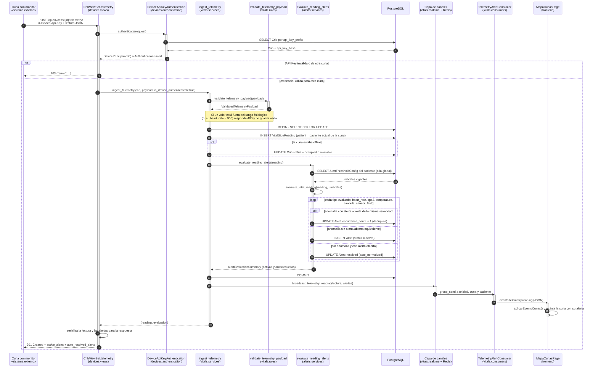

# 3. Diagrama de secuencia: Registrar telemetría

Caso de uso **CU-23 Registrar telemetría** del [diagrama de casos de uso](1-casos-de-uso.md): una cuna envía una lectura de signos vitales, el backend la valida y la guarda, evalúa las alertas y la difunde en tiempo real al mapa de cunas.

**Cómo leerlo.**

- La numeración automática permite citar cada mensaje en la presentación ("el mensaje 24 es la alerta que llega a la pantalla").
- Solo se dibujan los retornos que traen información. `broadcast_telemetry_reading` y `group_send` no devuelven nada útil, así que no tienen flecha de vuelta.
- En el `alt` de las alertas falta un caso, para no recargar el dibujo: si la severidad cambia (de advertencia a crítica), la alerta anterior se cierra como `severity_escalated` y se crea una nueva.

## Correspondencia con el código

| Línea de vida | Dónde está |
|---|---|
| Cuna con monitor | Actor externo de CU-23. En desarrollo lo reemplaza `simulate_telemetry` |
| `CribViewSet.telemetry` | `src/devices/views.py`, acción `telemetry` (`POST`) |
| `DeviceApiKeyAuthentication` | `src/devices/authentication.py`, cabecera `X-Device-Api-Key` |
| `ingest_telemetry` | `src/vitals/services.py` |
| `validate_telemetry_payload` | `src/vitals/rules.py` (fuente única de los rangos fisiológicos) |
| `evaluate_reading_alerts` | `src/alerts/services.py`, con `evaluate_vital_reading` de `src/alerts/policies.py` |
| Capa de canales | `src/vitals/realtime.py` (`broadcast_telemetry_reading`), Redis en producción |
| `TelemetryAlertConsumer` | `src/vitals/consumers.py`, ruta `ws/v1/monitoring/stream/` |
| `MapaCunasPage` | Frontend: `src/pages/mapa/MapaCunasPage.tsx` y `aplicarEventoCunas` en `src/services/cunasService.ts` |
