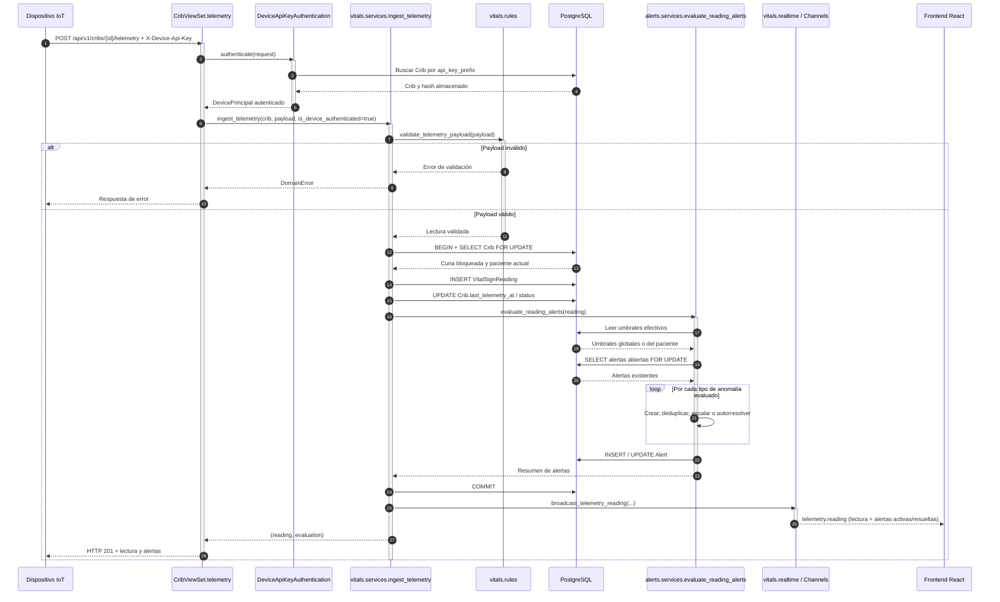

# 3. Diagrama de secuencia

**Caso elegido:** ingesta de una lectura de telemetría desde una cuna, evaluación de alertas y publicación en tiempo real.

## Justificación de decisiones

Se escogió la telemetría porque es un flujo central y técnicamente representativo: conecta el dispositivo IoT, la autenticación por API Key, la validación fisiológica, la persistencia, el motor de alertas y la interfaz en tiempo real. El flujo sigue `CribViewSet.telemetry` y `ingest_telemetry`; no se modela como si el dispositivo utilizara JWT de usuario. La transacción bloquea la fila de `Crib` para mantener consistentes el paciente asignado, la última marca de telemetría y el estado de la cuna. Después se evalúan umbrales efectivos y se sincronizan las alertas abiertas, incluyendo deduplicación y autorresolución. La difusión se hace después de la evaluación mediante `broadcast_telemetry_reading`, hacia los grupos de unidad, cuna y paciente. El fragmento `alt` distingue un payload inválido de uno aceptado y el `loop` representa la evaluación de los tipos de anomalía; los retornos muestran resultados que cambian el paso siguiente.

## Participantes y responsabilidades

- **Dispositivo IoT:** emite la lectura y presenta la API Key de la cuna.
- **CribViewSet.telemetry:** adapta la petición HTTP, selecciona autenticación y serializa la respuesta.
- **DeviceApiKeyAuthentication:** resuelve y valida la credencial del dispositivo.
- **ingest_telemetry:** coordina validación, persistencia transaccional, evaluación y difusión.
- **vitals.rules:** valida rangos y estructura de la telemetría.
- **PostgreSQL:** persiste lectura, estado de cuna y alertas.
- **evaluate_reading_alerts:** crea, deduplica, escala o autorresuelve alertas.
- **Channels / Frontend:** distribuye y recibe el evento `telemetry.reading`.
