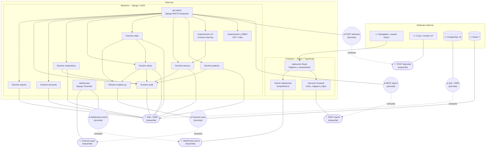

# 4. Diagrama de componentes

## Interfaces principales

| Interfaz | Proveedor | Consumidor | Propósito |
|---|---|---|---|
| `REST /api/v1` | Backend DRF | Servicios frontend | Operaciones de pacientes, cunas, signos vitales, alertas, farmacia, turnos y reportes. |
| `POST telemetry` | Backend DRF | Dispositivo IoT | Ingesta autenticada por `X-Device-Api-Key`; también admite personal autenticado según la vista. |
| `WebSocket /ws/v1` | Backend ASGI / Channels | Cliente WebSocket frontend | Eventos de telemetría y alertas con autenticación JWT. |
| `SQL / ORM` | PostgreSQL | Aplicaciones de dominio Django | Persistencia relacional de entidades y trazabilidad. |
| `Channel Layer` | Django Channels con Redis en despliegue | Servicios de difusión y consumidores WebSocket | Enrutamiento de eventos a grupos de unidad, cuna y paciente. |

## Justificación de decisiones

El backend se representa como monolito modular y no como microservicios: los dominios son aplicaciones Django dentro del mismo proceso y comparten transacciones y ORM. El frontend está separado porque es un repositorio y una aplicación React independiente que consume REST y WebSocket. Los dispositivos IoT se muestran como externos y utilizan una interfaz de ingesta autenticada con API Key; los usuarios del navegador consumen la API con sesión/JWT. PostgreSQL representa la persistencia principal y Redis la capa de canales para tiempo real en el despliegue Docker Compose documentado. Los módulos `patients`, `devices`, `vitals`, `alerts`, `medications`, `accounts`, `audit` y `reports` se muestran por separado para reflejar sus límites de dominio y sus responsabilidades. Las interfaces nombradas con puerto provisto y requerido explican el contrato entre capas sin reducir la arquitectura a cajas y flechas sin contrato.

## Componentes externos

- **Navegador:** ejecuta el frontend React.
- **Cuna / monitor IoT:** envía telemetría con API Key propia.
- **PostgreSQL 16:** base de datos relacional.
- **Redis 7:** backend de Channel Layer en la configuración Docker Compose descrita en el README del backend.