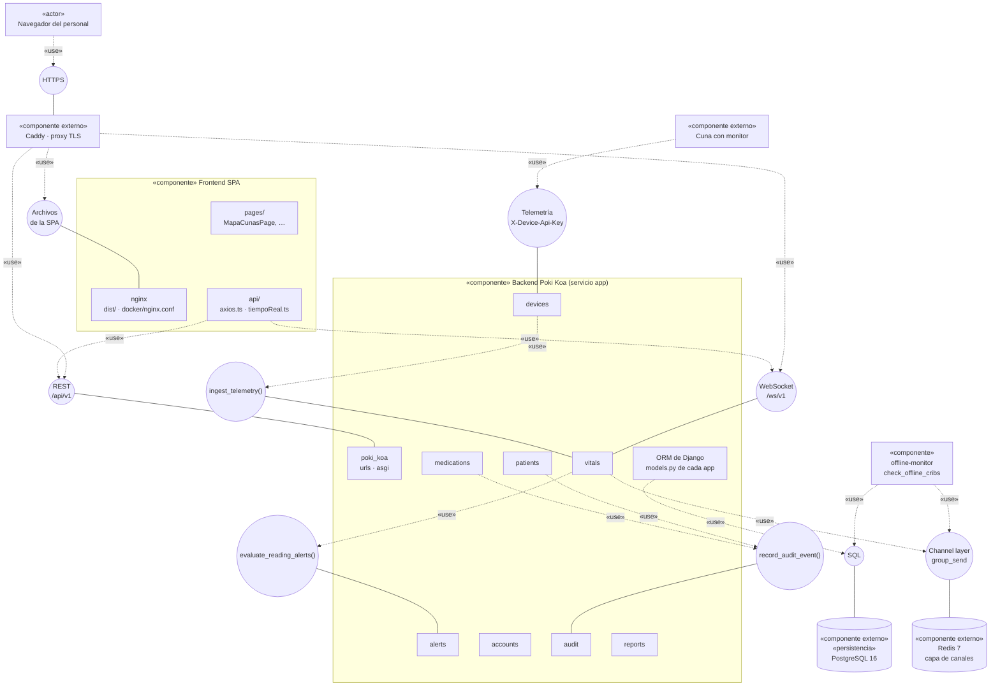

# 4. Diagrama de componentes

En qué piezas se divide Poki Koa en producción y qué interfaces las conectan. El backend, el `offline-monitor`, PostgreSQL y Redis se despliegan con `docker-compose.prod.yml`; el frontend (nginx) y Caddy se despliegan aparte, según `docs/info_despliegue.md`. Cada componente corresponde a una carpeta de este repositorio, a una carpeta de [PokiKoa/frontend](https://github.com/PokiKoa/frontend) o a un servicio del archivo de despliegue.

**Cómo leerlo.** Mermaid no tiene un tipo de diagrama de componentes, así que se representa con un diagrama de flujo:

- Cada recuadro es un componente. Los recuadros grandes (*Frontend SPA*, *Backend Poki Koa*) contienen sus módulos internos.
- Cada círculo es una **interfaz con nombre**. La línea continua sale del componente que la **provee** (la bola).
- La flecha punteada `«use»` sale de cada componente que la **requiere** (el enchufe).
- `«componente externo»` marca software que el equipo no escribió: la cuna, Caddy, PostgreSQL y Redis.
- La persistencia es PostgreSQL, el único componente con estado clínico. Dentro del backend, el ORM de Django (los `models.py` de cada aplicación) es el único que habla SQL.
- Todo corre en el servidor de cada centro con Docker, salvo el navegador y la cuna.
- Para no recargar el dibujo, solo dos aplicaciones de dominio aparecen usando `record_audit_event()`. En el código la llaman todos los servicios que modifican datos: `accounts`, `devices`, `patients`, `alerts` y `medications`.

## Correspondencia con el repositorio

| Componente o interfaz | Dónde existe |
|---|---|
| Frontend SPA (nginx) | Repositorio `PokiKoa/frontend`: `src/pages/`, `src/api/axios.ts`, `src/api/tiempoReal.ts`, `Dockerfile`, `docker/nginx.conf` |
| Backend Poki Koa | Servicio `app` de `docker-compose.prod.yml`: `src/poki_koa/` y las aplicaciones `src/accounts/`, `src/devices/`, `src/patients/`, `src/vitals/`, `src/alerts/`, `src/medications/`, `src/audit/`, `src/reports/` |
| offline-monitor | Servicio `offline-monitor` de `docker-compose.prod.yml`, comando `src/devices/management/commands/check_offline_cribs.py` |
| PostgreSQL 16 | Servicio `db` de `docker-compose.prod.yml`, configurado con `DATABASE_URL` |
| Redis 7 | Servicio `redis` de `docker-compose.prod.yml`, configurado con `REDIS_URL` (`CHANNEL_LAYERS` en `src/poki_koa/settings/base.py`) |
| Caddy | Proxy del servidor de cada centro, configurado según `docs/info_despliegue.md` |
| REST `/api/v1` | `src/poki_koa/urls.py`, contrato en `openapi/schema.yml` |
| WebSocket `/ws/v1` | `src/vitals/routing.py` y `src/vitals/consumers.py` |
| Telemetría `X-Device-Api-Key` | `src/devices/authentication.py` y la acción `telemetry` de `src/devices/views.py` |
| `ingest_telemetry()` · `evaluate_reading_alerts()` · `record_audit_event()` | `src/vitals/services.py` · `src/alerts/services.py` · `src/audit/services.py` |

## Nota de lectura

Separamos el sistema según qué puede fallar o cambiar sin arrastrar al resto. El `offline-monitor` es un proceso aparte porque detectar una cuna desconectada es reaccionar a la **ausencia** de peticiones, algo que la API no puede hacer sola; si se cae, la API sigue atendiendo. Redis queda detrás de la interfaz *Channel layer*: es la pieza que se puede **reemplazar sin tocar código**, porque sin `REDIS_URL` el backend usa `InMemoryChannelLayer`, que sirve para un solo proceso. Con Redis, los eventos llegan a todos los procesos de uvicorn y también los del monitor. El Temporizador del caso de uso *CU-26 Detectar cunas desconectadas* no es un componente aparte: es el `--every 60` del propio `offline-monitor`, que se despierta cada 60 segundos sin que nadie lo llame. La cuna física tampoco es imprescindible: el comando `simulate_telemetry` la reemplaza usando la misma interfaz *Telemetría `X-Device-Api-Key`*. Dentro del backend, cada aplicación expone servicios y no modelos, por ejemplo `ingest_telemetry()` y `evaluate_reading_alerts()`, los mismos mensajes que muestra el diagrama de secuencia.
