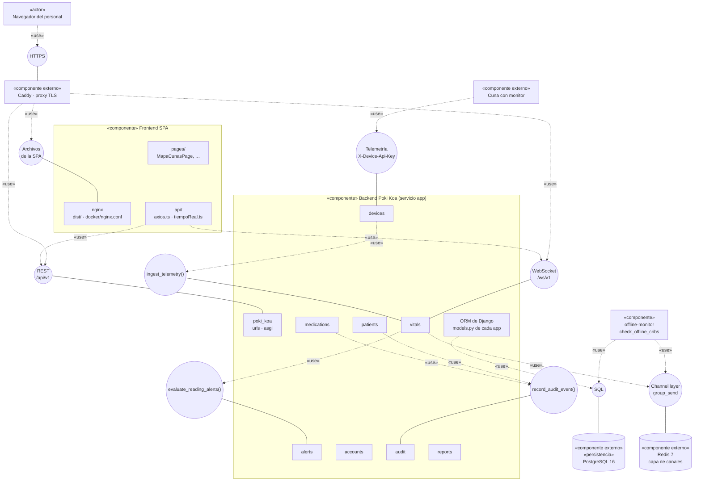

# 4. Diagrama de componentes

En qué piezas se divide Poki Koa cuando se despliega con `docker-compose.prod.yml` y qué interfaces las conectan. Cada componente corresponde a una carpeta de este repositorio, a una carpeta de [PokiKoa/frontend](https://github.com/PokiKoa/frontend) o a un servicio del archivo de despliegue.

**Cómo leerlo.** Mermaid no tiene un tipo de diagrama de componentes, así que se representa con un diagrama de flujo:

- Cada recuadro es un componente. Los recuadros grandes (*Frontend SPA*, *Backend Poki Koa*) contienen sus módulos internos.
- Cada círculo es una **interfaz con nombre**. La línea continua sale del componente que la **provee** (la bola).
- La flecha punteada `«use»` sale de cada componente que la **requiere** (el enchufe).
- `«componente externo»` marca software que el equipo no escribió: la cuna, Caddy, PostgreSQL y Redis.
- La persistencia es PostgreSQL, el único componente con estado clínico. Dentro del backend, el ORM de Django (los `models.py` de cada aplicación) es el único que habla SQL.
- Todo corre en el servidor de cada centro con Docker, salvo el navegador y la cuna.
- Para no recargar el dibujo, solo dos aplicaciones de dominio aparecen usando `record_audit_event()`. En el código la llaman todos los servicios que modifican datos: `accounts`, `devices`, `patients`, `alerts` y `medications`.
